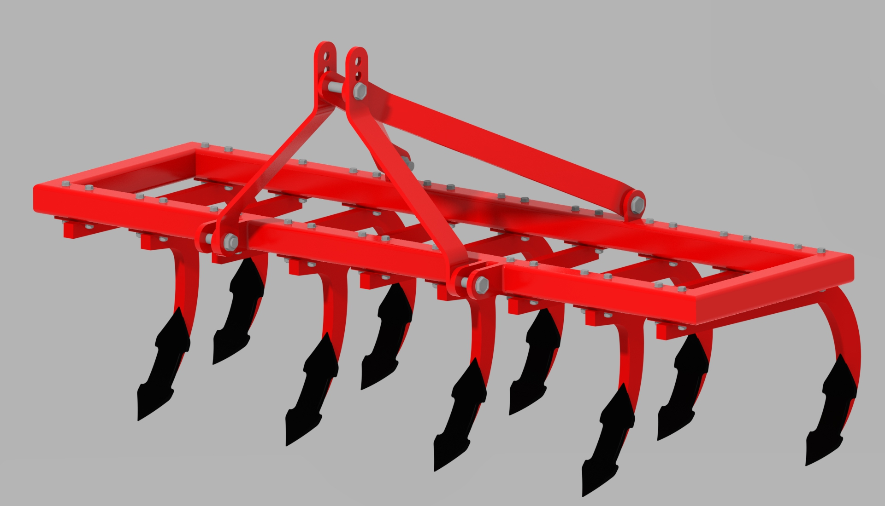
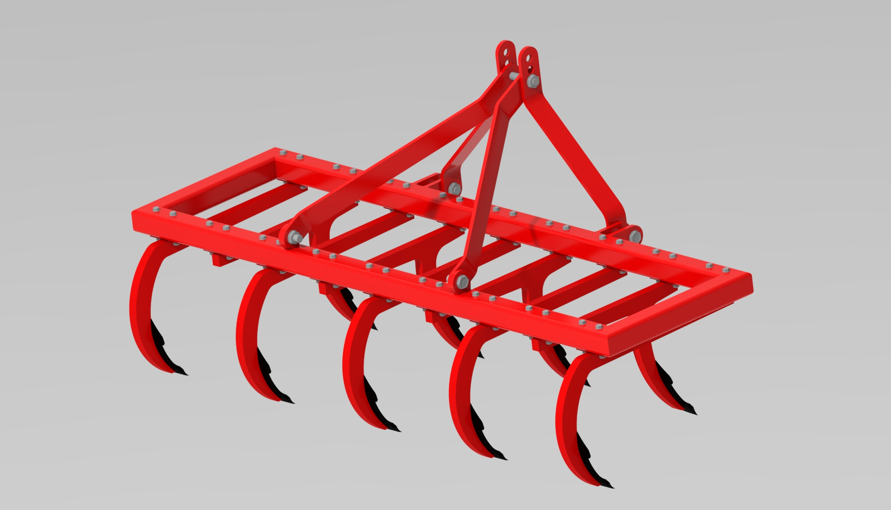
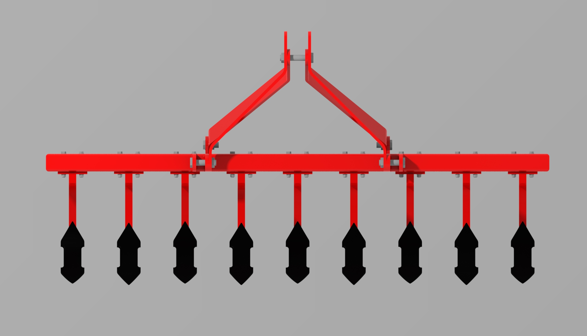
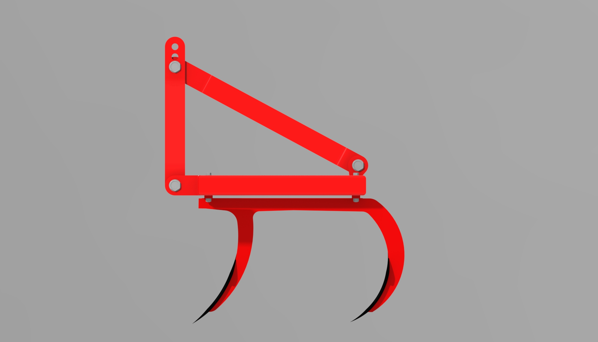
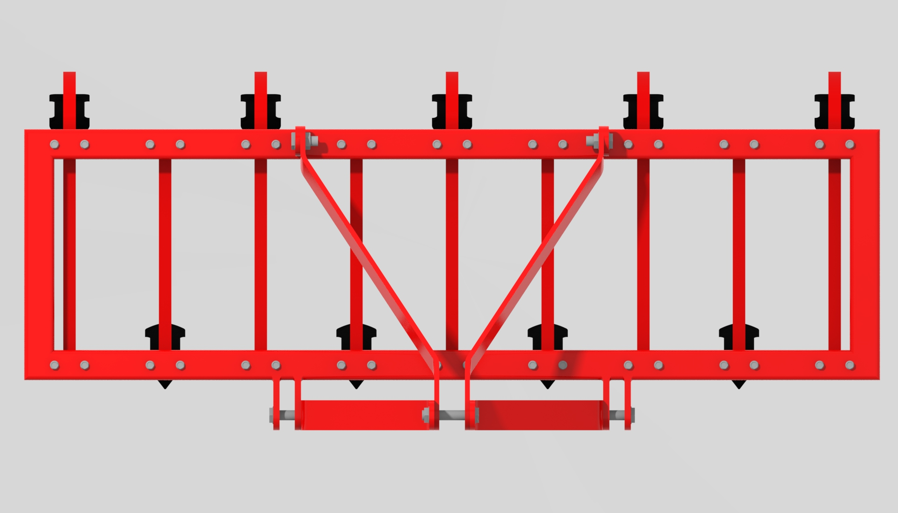
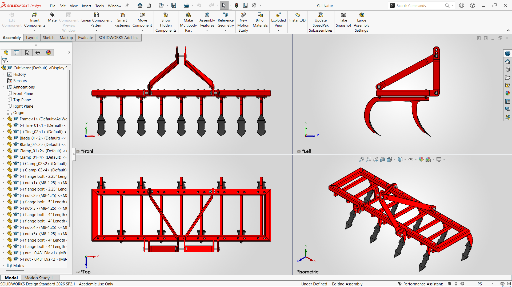
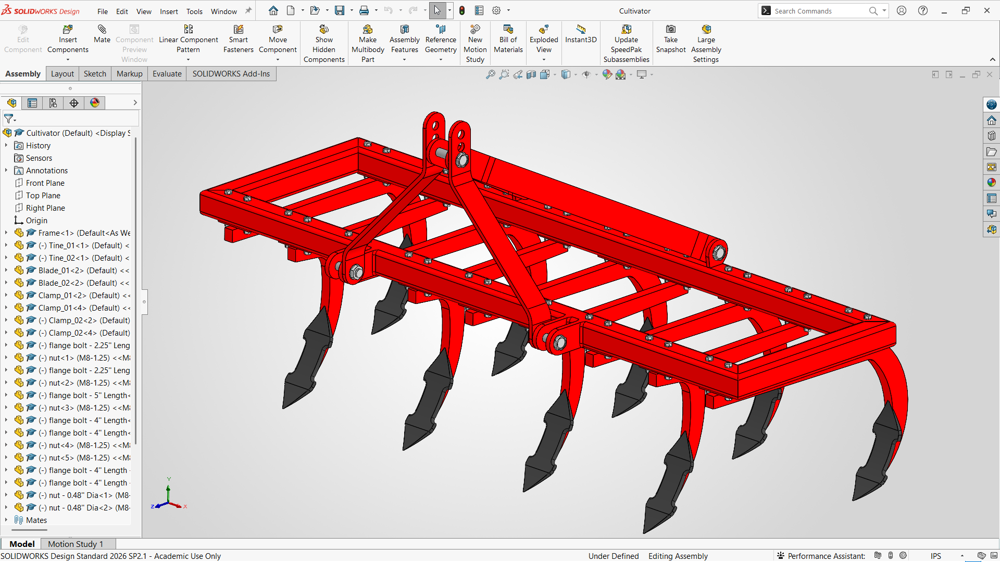

# Agricultural Cultivator — SolidWorks CAD Design

<p align="center">
  
</p>

<p align="center">
  <strong>3D CAD Design, Part Modeling & Assembly of an Agricultural Cultivator</strong>
</p>

<p align="center">
  A SolidWorks-based mechanical design project developed for agricultural machinery design and engineering documentation.
</p>

---

## 📌 Project Overview

This repository contains the complete **3D CAD model of an agricultural cultivator**, developed in **SOLIDWORKS** as a mechanical design and assembly project.

The model represents a rigid-frame agricultural implement consisting of a fabricated structural frame, multiple curved tines, replaceable blade components, clamps, mounting hardware, and a three-point linkage arrangement.

The project is organized as a complete SolidWorks design package containing:

- Individual **part files (`.SLDPRT`)**
- A complete **assembly file (`.SLDASM`)**
- Agricultural implement components such as frame, tines, blades, and clamps
- Fastener/hardware models
- Rendered design views
- SolidWorks screenshots showing the modeling and assembly environment

The repository is intended to serve as a **CAD portfolio project, agricultural engineering design reference, academic project, and starting point for further mechanical design development**.

---

## 🎯 Design Objective

The primary objective of this project is to develop a detailed 3D CAD representation of an **agricultural cultivator implement** suitable for studying:

- Agricultural machinery configuration
- Soil-cultivation implement geometry
- Structural frame arrangement
- Tine and blade placement
- Mechanical fastening
- Part-to-part assembly
- Three-point tractor implement mounting
- Parametric CAD modeling
- Assembly visualization and documentation

The design can be further developed into a production-oriented engineering design by adding verified dimensions, material specifications, manufacturing drawings, structural calculations, weld details, tolerance specifications, and field-performance validation.

> **Important:** This repository documents the CAD model supplied with the project. Manufacturing dimensions, material grades, load ratings, operating depth, tractor power requirements, and field-performance specifications should not be assumed unless separately documented and experimentally or analytically verified.

---

## 🖼️ Design Preview

### Isometric View

<p align="center">
  
</p>

### Rear Isometric View

<p align="center">
  
</p>

### Front View

<p align="center">
  
</p>

### Side View

<p align="center">
  
</p>

### Top View

<p align="center">
  
</p>

---

## 🧩 Main Components

The assembly is divided into three logical groups: **structural/functional parts, hardware, and the final assembly**.

### 1. Structural & Functional Parts

| Component | File | Description |
|---|---|---|
| Frame | `Parts/Frame.SLDPRT` | Main structural frame of the cultivator |
| Tine 01 | `Parts/Tine_01.SLDPRT` | Curved tine component |
| Tine 02 | `Parts/Tine_02.SLDPRT` | Associated tine component |
| Blade 01 | `Parts/Blade_01.SLDPRT` | Cultivator blade / soil-engaging component |
| Blade 02 | `Parts/Blade_02.SLDPRT` | Associated blade component |
| Clamp 01 | `Parts/Clamp_01.SLDPRT` | Tine/blade mounting or clamping component |
| Clamp 02 | `Parts/Clamp_02.SLDPRT` | Associated clamping component |

### 2. Hardware

| Component | File | Description |
|---|---|---|
| Nut | `Hardware/nut.SLDPRT` | General nut model |
| Nut Ø0.48 in | `Hardware/nut - 0.48'' Dia.SLDPRT` | Specified-diameter nut model |
| Flange Bolt — 2.25 in | `Hardware/flange bolt - 2.25'' Length.SLDPRT` | Flange bolt model |
| Flange Bolt — 4 in | `Hardware/flange bolt - 4'' Length.SLDPRT` | Flange bolt model |
| Flange Bolt — 4 in / Ø0.48 in | `Hardware/flange bolt - 4'' Length - 0.48'' Dia.SLDPRT` | Specified-length and diameter bolt model |
| Flange Bolt — 5 in | `Hardware/flange bolt - 5'' Length.SLDPRT` | Flange bolt model |

### 3. Final Assembly

| File | Purpose |
|---|---|
| `Assembly/Cultivator.SLDASM` | Main SolidWorks assembly containing the cultivator design |

---

## 🏗️ Design Architecture

The CAD model follows a conventional agricultural implement assembly architecture:

```text
                    Tractor / Three-Point Hitch
                              │
                              ▼
                    ┌─────────────────┐
                    │   Hitch Frame   │
                    └────────┬────────┘
                             │
                             ▼
              ┌────────────────────────────┐
              │      Main Structural       │
              │          Frame             │
              └────────────┬───────────────┘
                           │
            ┌──────────────┼──────────────┐
            │              │              │
            ▼              ▼              ▼
         Clamps          Tines        Fasteners
            │              │
            ▼              ▼
        Blade Mount    Soil-Engaging
            │           Components
            ▼              │
         Blades ◄──────────┘
```

This arrangement separates the design into:

1. **Load-supporting structure**
2. **Mounting/linkage structure**
3. **Tine assemblies**
4. **Soil-engaging blade components**
5. **Mechanical fastening hardware**

---

## ⚙️ CAD Design Features

The project demonstrates several practical CAD modeling concepts relevant to agricultural and mechanical engineering.

### Parametric Part Modeling

Individual components are modeled as separate SolidWorks part files. This makes it possible to modify a component independently and reuse it within the assembly.

### Assembly Modeling

The `Cultivator.SLDASM` file brings the individual components together into a complete implement assembly.

### Component-Based Design

The design is divided into logical components instead of representing the entire implement as a single solid body. This approach is useful for:

- Design revisions
- Component replacement
- Manufacturing planning
- Assembly documentation
- BOM development
- Maintenance-oriented design

### Agricultural Implement Geometry

The model includes:

- Structural frame members
- Curved soil-engaging tines
- Blade components
- Clamping arrangements
- Fastening hardware
- Three-point mounting geometry

### Visualization

The repository includes multiple rendered views and SolidWorks screenshots to communicate the design from different perspectives.

---

## 📁 Repository Structure

```text
Cultivator/
│
├── Assembly/
│   └── Cultivator.SLDASM
│
├── Hardware/
│   ├── flange bolt - 2.25'' Length.SLDPRT
│   ├── flange bolt - 4'' Length.SLDPRT
│   ├── flange bolt - 4'' Length - 0.48'' Dia.SLDPRT
│   ├── flange bolt - 5'' Length.SLDPRT
│   ├── nut - 0.48'' Dia.SLDPRT
│   └── nut.SLDPRT
│
├── Parts/
│   ├── Blade_01.SLDPRT
│   ├── Blade_02.SLDPRT
│   ├── Clamp_01.SLDPRT
│   ├── Clamp_02.SLDPRT
│   ├── Frame.SLDPRT
│   ├── Tine_01.SLDPRT
│   └── Tine_02.SLDPRT
│
├── Images/
│   ├── cultivator-front.jpg
│   ├── cultivator-isometric.jpg
│   ├── cultivator-isometric-rear.jpg
│   ├── cultivator-side.jpg
│   └── cultivator-top.jpg
│
├── Screenshots/
│   ├── 1.png
│   ├── 2.png
│   └── 3.png
│
└── README.md
```

---

## 🖥️ Software Requirements

### Required

- **SOLIDWORKS** capable of opening `.SLDPRT` and `.SLDASM` files

### Recommended

- Windows workstation capable of running the installed SolidWorks release
- Adequate GPU/graphics support for 3D CAD visualization
- Sufficient RAM for assembly operations

### File Compatibility

SolidWorks files are version-dependent. If the project was created in a newer SolidWorks release, an older release may not be able to open or edit the files directly.

For best results:

1. Open the main assembly first.
2. Allow SolidWorks to resolve referenced components.
3. Keep the repository folder structure unchanged.
4. If references are missing, use **File → Find References** or the SolidWorks reference-management tools to locate the component files.
5. Save a working copy before performing major modifications.

---

## 🚀 How to Open the Project

### Method 1 — Open the Assembly

1. Clone or download this repository.
2. Open the project directory in Windows.
3. Launch **SOLIDWORKS**.
4. Open:

```text
Assembly/Cultivator.SLDASM
```

5. Confirm that all referenced `.SLDPRT` files are resolved.
6. Rebuild the assembly if required.
7. Inspect the assembly using the standard SolidWorks view controls.

### Method 2 — Inspect Individual Components

Individual components can be opened independently:

```text
Parts/Frame.SLDPRT
Parts/Tine_01.SLDPRT
Parts/Tine_02.SLDPRT
Parts/Blade_01.SLDPRT
Parts/Blade_02.SLDPRT
Parts/Clamp_01.SLDPRT
Parts/Clamp_02.SLDPRT
```

Hardware models are available in:

```text
Hardware/
```

---

## 🔍 Assembly Inspection Workflow

For engineering review, the following workflow is recommended:

### Step 1 — Inspect the Frame

Review:

- Overall frame arrangement
- Cross-members
- Mounting locations
- Hitch structure
- Tine attachment locations

### Step 2 — Inspect the Tines

Review:

- Curvature
- Orientation
- Spacing
- Mounting interface
- Relationship to the frame

### Step 3 — Inspect the Blades

Review:

- Blade geometry
- Blade-to-tine connection
- Soil-engaging orientation
- Replaceability of the blade component

### Step 4 — Inspect the Clamps

Review:

- Clamping arrangement
- Fastener locations
- Tine retention
- Mechanical interfaces

### Step 5 — Inspect the Hardware

Review the supplied bolt and nut models and verify that the selected hardware corresponds to the intended joint configuration.

### Step 6 — Review the Complete Assembly

Check:

- Component alignment
- Interference between components
- Fastener placement
- Symmetry/spacing
- Hitch geometry
- Overall implement configuration

---

## 📐 Engineering Development Opportunities

The current repository primarily represents the **3D CAD design and assembly**. A production-ready engineering package would require additional documentation and validation.

Possible future engineering work includes:

### Structural Analysis

- Static structural analysis
- Tine bending analysis
- Frame stress analysis
- Fastener load analysis
- Weld/joint analysis
- Factor-of-safety evaluation

### Soil Interaction

- Soil resistance estimation
- Draft-force calculation
- Tine penetration analysis
- Blade geometry optimization
- Operating-depth evaluation
- Soil disturbance analysis

### Tractor Compatibility

- Three-point hitch category verification
- Tractor power requirement estimation
- Draft-force compatibility
- Lift-capacity verification
- Transport clearance evaluation

### Manufacturing Documentation

- Detailed engineering drawings
- GD&T
- Weld symbols
- Material specifications
- Surface-finish requirements
- Cutting and bending details
- Hardware specifications
- Bill of Materials (BOM)

### Design Optimization

- Weight reduction
- Frame stiffness improvement
- Tine spacing optimization
- Modular blade replacement
- Manufacturability improvements
- Cost optimization

---

## 🧪 Validation & Verification

Before using a CAD model for manufacturing or field operation, the design should be independently validated.

Recommended verification includes:

| Area | Verification |
|---|---|
| Geometry | Check critical dimensions and interfaces |
| Assembly | Verify mates, clearances, and interference |
| Structure | Perform structural/load analysis |
| Tines | Verify bending strength and fatigue requirements |
| Blades | Verify wear and attachment requirements |
| Fasteners | Verify size, grade, preload, and joint capacity |
| Hitch | Verify three-point linkage compatibility |
| Manufacturing | Confirm material, fabrication, welding, and machining requirements |
| Field Use | Validate operating depth, draft requirement, and soil interaction |

> **Engineering note:** The presence of a CAD model does not by itself establish structural safety, manufacturing suitability, or field-operating performance.

---

## 📸 SolidWorks Screenshots

### Assembly Configuration



### Assembly Visualization


### Detailed Assembly View



---

## 🛠️ Recommended Git Workflow

Because SolidWorks files are binary CAD files, a disciplined Git workflow is useful.

### Clone the Repository

```bash
git clone https://github.com/karthikeyana-tech/<repository-name>.git
cd <repository-name>
```

Replace `<repository-name>` with the actual GitHub repository name.

### Check Repository Status

```bash
git status
```

### Add Changes

```bash
git add .
```

### Commit Changes

```bash
git commit -m "Update cultivator CAD design"
```

### Push Changes

```bash
git push origin main
```

### Recommended Commit Examples

```text
Initial cultivator CAD assembly
Add cultivator frame and tine components
Add blade and clamp components
Add hardware models
Update assembly configuration
Add rendered design views
Update project documentation
```

---

## 📦 Git Large File Storage (Optional)

The current project files are relatively small enough for normal Git hosting. However, future SolidWorks projects can become significantly larger.

For large CAD files, consider using **Git LFS (Large File Storage)**.

Example:

```bash
git lfs install
git lfs track "*.SLDPRT"
git lfs track "*.SLDASM"
git add .gitattributes
git add .
git commit -m "Configure Git LFS for SolidWorks files"
git push origin main
```

Use Git LFS when individual CAD files become large enough to make normal Git repository storage inconvenient.

---

## 📋 Project Deliverables

The repository currently contains the following major deliverables:

- [x] Main SolidWorks assembly
- [x] Frame part
- [x] Tine components
- [x] Blade components
- [x] Clamp components
- [x] Bolt models
- [x] Nut models
- [x] Isometric render
- [x] Front view
- [x] Side view
- [x] Top view
- [x] Rear isometric view
- [x] SolidWorks screenshots
- [x] GitHub documentation

Potential future deliverables:

- [ ] Fully dimensioned manufacturing drawings
- [ ] Bill of Materials
- [ ] Material specifications
- [ ] Weldment documentation
- [ ] Structural simulation
- [ ] Design calculations
- [ ] Manufacturing cost estimation
- [ ] Tractor compatibility study
- [ ] Field testing documentation

---

## 🎓 Academic / Engineering Context

This project demonstrates the application of **agricultural engineering and mechanical CAD principles** to the design of an agricultural implement.

Relevant engineering areas include:

- Agricultural machinery design
- Farm mechanization
- Soil-engaging implements
- Machine design
- Mechanical component modeling
- Structural design
- CAD-based engineering
- 3D assembly modeling
- Design visualization
- Engineering documentation

The project can be used as a portfolio example to demonstrate practical experience with **agricultural machinery CAD design and SolidWorks assembly modeling**.

---

## 👨‍💻 Author

**Mr. A. KARTHIKEYAN**

**B. Tech. (Honors). Agricultural Engineering**

Agricultural Engineering | CAD Design | Agricultural Machinery | Mechanical Design

### Contact

- **GitHub:** [karthikeyana-tech](https://github.com/karthikeyana-tech)
- **Email:** [karthikeyana.tech@gmail.com](mailto:karthikeyana.tech@gmail.com)
- **Phone:** `+91 63801 72221`

---

## 📄 License

**Copyright © 2026 Mr. A. KARTHIKEYAN. All Rights Reserved.**

This repository and all materials contained within it, including but not limited to:

- SolidWorks part files (`.SLDPRT`)
- SolidWorks assembly files (`.SLDASM`)
- CAD models and geometry
- Design concepts and configurations
- Rendered images
- Screenshots
- Documentation
- Drawings or derivative engineering documentation, where applicable

are the **exclusive intellectual property of Mr. A. KARTHIKEYAN**, unless otherwise stated.

### Usage Restrictions

No permission is granted to:

- Copy or redistribute the CAD files
- Modify or create derivative CAD designs
- Re-upload the project or its files to another repository
- Use the CAD models for commercial manufacturing
- Manufacture products based on these CAD files
- Sell, license, sublicense, or commercially exploit the design
- Incorporate the design into another commercial or public CAD project
- Claim the design or derivative work as your own

without **prior written permission from the author**.

### Portfolio / Reference Use

The GitHub repository is published for **portfolio presentation, professional reference, academic visibility, and documentation purposes**.

Viewing the repository does not grant ownership or any implied license to the underlying CAD files or design.

If you require permission to use, modify, manufacture, reproduce, or commercially exploit any part of this project, please contact the author.

### Permission Requests

**Author:** Mr. A. KARTHIKEYAN  
**Email:** [karthikeyana.tech@gmail.com](mailto:karthikeyana.tech@gmail.com)  
**GitHub:** [karthikeyana-tech](https://github.com/karthikeyana-tech)

Unless explicitly authorized in writing, **all rights are reserved**.

## ⚠️ Disclaimer

This repository contains a CAD representation of an agricultural cultivator.

The CAD model should not be treated as a certified manufacturing drawing, safety-certified agricultural implement, or validated field machine unless the necessary engineering calculations, material specifications, manufacturing documentation, testing, and applicable standards/compliance requirements have been completed.

Before manufacturing or operating a physical machine based on this model, verify:

- Structural strength
- Material properties
- Fastener specifications
- Weld/joint strength
- Tractor compatibility
- Three-point hitch compatibility
- Operating loads
- Soil conditions
- Safety clearances
- Manufacturing tolerances
- Applicable agricultural machinery requirements

---

## ⭐ Project Summary

**Agricultural Cultivator — SolidWorks CAD Design** is a complete 3D mechanical assembly representing an agricultural soil-cultivation implement.

The repository combines **parametric part models, assembly modeling, hardware components, rendered views, and engineering documentation** into a structured CAD project suitable for academic work, engineering portfolios, design studies, and future development.

---

<p align="center">
  <strong>Designed and documented by Mr. A. KARTHIKEYAN</strong><br>
  <em>B. Tech. (Honors). Agricultural Engineering</em>
</p>
